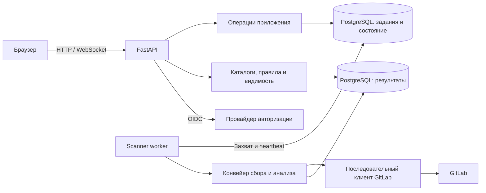
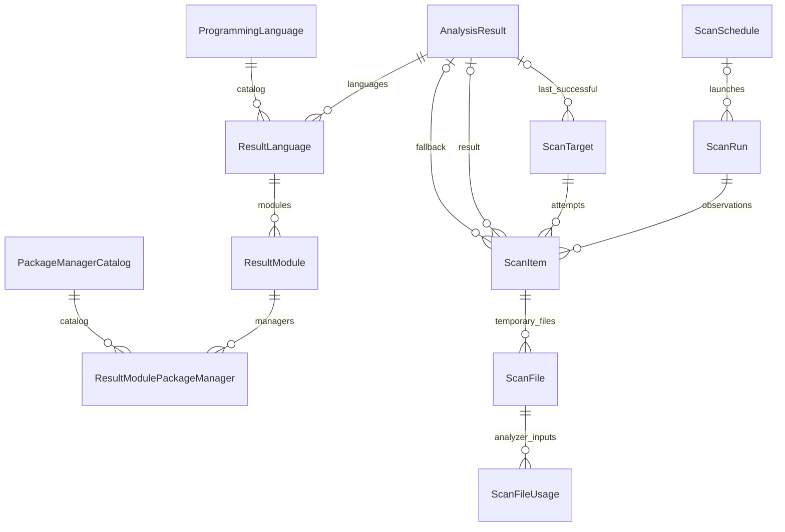

# Архитектура и данные

## Компоненты

Поддерживается одна web-реплика. API и scanner взаимодействуют через задания и состояние в БД.
Роуты не вызывают worker и не читают его локальное состояние. По умолчанию worker запускается
lifespan приложения в том же процессе; отдельный контейнер и брокер не нужны.

Пакет `scanner` не зависит от FastAPI. В нем находятся worker, конвейер, сборщик и кооперативная
остановка потоков. `application.scans` содержит операции постановки, остановки и чтения состояния;
`database.scan_jobs` — очередь, а `database.scan_authority` — проверку прав исполнителя на запись.
Общие сигналы и исключения находятся в `domain`. Подключение БД не зависит от HTTP lifecycle.

Для будущего выделения процесса предусмотрен `python -m gitlab_radar.scanner`; текущая команда
контейнера не меняется. При таком разделении web-сборка должна перестать запускать встроенный worker.
Планировщик внутри worker создает те же задания по сохраненным расписаниям;
ручной запуск, расписания и повторы используют общий допуск и параметры.
Устройство и API: [расписания и история](schedules.md).

Frontend — нативные ES-модули с точкой входа `app.js`. Состояние проектов, обзора, сканирования
и каждого каталога разделено; связи между файлами заданы импортами. Статика и импортируемые модули
используют общую версию по содержимому файлов. Подробности: [устройство frontend](frontend.md). Чтение готовых результатов учитывает сохраненный прогресс запуска,
поэтому не требует локального вызова из scanner для инвалидации web-кэша.
Проекты и каталоги зависимостей используют общую версию: ID запуска, число обработанных проектов,
состояние, публикация и локальная ревизия настроек. Изменения требований, языков, параметров
и черного списка сбрасывают эту ревизию. Одновременные запросы используют одну сборку кеша;
инвалидация во время чтения не позволяет сохранить результат под устаревшей версией.

Текущие данные читаются через пункты выбранного запуска и указатели `ScanTarget`, без обхода
прошлых запусков. Для повторного анализа сначала проверяется последний завершенный пункт цели,
затем индексированный каталог `AnalysisResult`. Пакетное чтение ограничивает выборку нужными ID
еще на уровне SQL. WebSocket передает счетчик изменений, сами ID читаются порциями по курсору.

## Основные сущности

`ScanRun` также является заданием очереди: хранит источник, инициатора, время создания и старта,
владельца, heartbeat, запрос остановки и прогресс. Ожидающее задание еще не имеет `started_at`.

`ScanTarget` задает цель: GitLab-проект, тип и ref. Сейчас собирается только основная ветка;
модель допускает отдельные цели для других веток и MR. При смене основной ветки прежняя цель
сохраняется в истории, а каталог переключается на новую.

`AnalysisResult` хранит неизменяемый результат разбора: модули, зависимости, статусы и диагностику.
У него есть fingerprint анализаторов и отпечаток входных файлов. Одинаковый результат для одинаковых
входов хранится один раз; новый запуск ссылается на него. Языки, модули и менеджеры дополнительно
сохранены в связанных таблицах на уровне результата, а не копируются для каждого запуска.

`ScanItem` — наблюдение цели в конкретном запуске: revision, метаданные, статус, ошибка и ссылки
на результат попытки и fallback. Поэтому неудачная попытка не заменяет прошлый успешный анализ,
а история не зависит от сегодняшних указателей. GitLab-метаданные, языковые проценты и webhook
обновляются отдельно от результата разбора.

Цель хранит указатели на последнюю попытку, завершенное наблюдение и последний успешный результат.
Результат, его связанные записи и указатели сохраняются одной транзакцией. Временные `ScanFile`
и `ScanFileUsage` удаляются после анализа. Используемый результат не удаляется при очистке старых запусков.

Справочники языков, фреймворков, требований и параметры независимы от результатов.
Сессии, WebSocket-билеты, пользователи и правила видимости — отдельные сущности.
`ApplicationSecret` хранит ключ маскирования webhook; `DataFixture` отмечает применение fixtures.

Актуальность, fallback и очистка истории: [сканирование](scanning.md).

## Исходный код

| Каталог | Ответственность |
|---|---|
| `src/gitlab_radar/api` | HTTP и WebSocket endpoints |
| `src/gitlab_radar/schemas` | Контракты данных, статусы и валидация |
| `src/gitlab_radar/scanner` | Worker, сборщик, конвейер и остановка |
| `src/gitlab_radar/application` | Операции постановки, остановки и чтения заданий |
| `src/gitlab_radar/domain` | Общие сигналы и исключения |
| `src/gitlab_radar/clients` | Клиент GitLab с проверкой разрешений и таймаутами |
| `src/gitlab_radar/services` | Сбор, анализ, правила, каталоги и статистика |
| `src/gitlab_radar/database` | ORM-модели, repository, fixtures и миграции |
| `src/gitlab_radar/config` | Настройки приложения |
| `web` | Интерфейс и статические ресурсы |
| `deploy` | Подготовка PostgreSQL |

## Модели БД

Модели находятся в пакете `database/models`; у каждой конкретной модели явно задано имя таблицы.

| Модуль | Сущности |
|---|---|
| `base.py` | Общая абстрактная модель |
| `scanning.py` | Запуски, цели, наблюдения и временные файлы |
| `analysis.py` | Результаты, языки и модули анализа |
| `catalogs.py` | Языки, фреймворки и пакетные менеджеры |
| `access.py` | Пользователи, сессии и WebSocket-билеты |
| `visibility.py` | Личные и административные правила видимости |
| `requirements.py` | Требования компании и их группы |
| `settings.py` | Параметры, служебные ключи, fixtures и черный список |

`models/__init__.py` сохраняет общий интерфейс импорта и явно перечисляет ORM-модели в `__models__`.
При добавлении модели нужно включить её в этот реестр. Ссылки внешних ключей используют прежние имена
`models.<ClassName>`; конфигурация Tortoise не зависит от разбиения на файлы.

Правила обновления схемы: [миграции](deployment.md#история-миграций).

## API

API начинается с `/api/`. Интерактивное описание FastAPI доступно по `/docs`, OpenAPI — `/openapi.json`.
Основные группы: проекты, зависимости, dashboard, scan, справочники, пользователи, auth и visibility.
`/api/project/?scan_id=<id>` и `/api/project/<project_id>?scan_id=<id>` читают данные выбранного запуска.
Без `scan_id` возвращается текущий каталог. Видимость и требования применяются по текущим настройкам.
Контракты и права конкретных операций задаются router и схемами; общая модель доступа описана
в [авторизации](access.md).

Новый анализатор реализует `LanguageAnalyzer`, регистрируется в registry и объявляет версию,
пакетные менеджеры, выбор файлов и локальный анализ. При изменении результата разбора повышается
версия анализатора; при изменении общего анализа — `PROJECT_ANALYZER_VERSION`.
