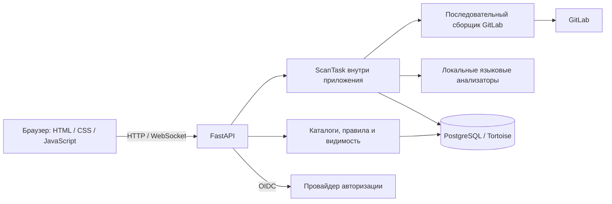
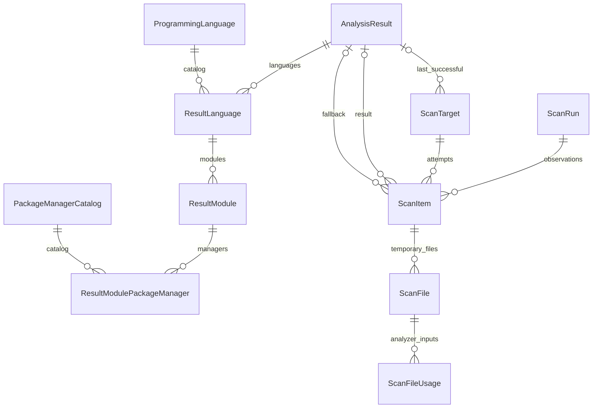

# Архитектура и данные

## Компоненты

Поддерживается одна web-реплика. Сканирование работает фоновым заданием внутри приложения;
отдельного scanner-сервиса, очереди заданий и планировщика пока нет.
Процесс использует PostgreSQL advisory lock для ограничения одновременных запусков.

FastAPI обслуживает API и статические файлы. Frontend — обычные JavaScript-скрипты с общим состоянием.
Статика использует постоянный маршрут и версию по содержимому файлов.

## Основные сущности

`ScanTarget` задает цель: GitLab-проект, тип и ref. Сейчас собирается только основная ветка;
модель допускает отдельные цели для других веток и MR. При смене основной ветки прежняя цель
сохраняется в истории, а каталог переключается на новую.

`AnalysisResult` хранит неизменяемый результат разбора: модули, зависимости, статусы и диагностику.
У него есть fingerprint анализаторов и отпечаток входных файлов. Одинаковый результат для одинаковых
входов хранится один раз; новый запуск ссылается на него. Языки, модули и менеджеры дополнительно
сохранены в связанных таблицах на уровне результата, а не копируются для каждого запуска.

`ScanItem` — наблюдение цели в конкретном запуске: revision, метаданные, статус, ошибка и ссылки
на результат попытки и fallback. Поэтому неудачная попытка не заменяет прошлый успешный анализ,
а история не зависит от сегодняшних указателей. GitLab-метаданные, языковые проценты и webhook
обновляются отдельно от результата разбора.

Цель хранит указатели на последнюю попытку, завершенное наблюдение и последний успешный результат.
Результат, его связанные записи и указатели сохраняются одной транзакцией. Временные `ScanFile`
и `ScanFileUsage` удаляются после анализа. Используемый результат не удаляется при очистке старых запусков.

Справочники языков, фреймворков, требований и параметры независимы от результатов.
Сессии, WebSocket-билеты, пользователи и правила видимости — отдельные сущности.
`ApplicationSecret` хранит ключ маскирования webhook; `DataFixture` отмечает применение fixtures.

Актуальность, fallback и очистка истории: [сканирование](scanning.md).

## Исходный код

| Каталог | Ответственность |
|---|---|
| `src/gitlab_radar/api` | HTTP и WebSocket endpoints |
| `src/gitlab_radar/schemas` | Контракты данных, статусы и валидация |
| `src/gitlab_radar/tasks` | Оркестрация сканирования |
| `src/gitlab_radar/clients` | Клиент GitLab |
| `src/gitlab_radar/services` | Сбор, анализ, правила, каталоги и статистика |
| `src/gitlab_radar/database` | ORM-модели, repository, fixtures и миграции |
| `src/gitlab_radar/config` | Настройки приложения |
| `web` | Интерфейс и статические ресурсы |
| `deploy` | Подготовка PostgreSQL |

## Модели БД

Модели находятся в пакете `database/models`; у каждой конкретной модели явно задано имя таблицы.

| Модуль | Сущности |
|---|---|
| `base.py` | Общая абстрактная модель |
| `scanning.py` | Запуски, цели, наблюдения и временные файлы |
| `analysis.py` | Результаты, языки и модули анализа |
| `catalogs.py` | Языки, фреймворки и пакетные менеджеры |
| `access.py` | Пользователи, сессии и WebSocket-билеты |
| `visibility.py` | Личные и административные правила видимости |
| `requirements.py` | Требования компании и их группы |
| `settings.py` | Параметры, служебные ключи, fixtures и черный список |

`models/__init__.py` сохраняет общий интерфейс импорта и явно перечисляет ORM-модели в `__models__`.
При добавлении модели нужно включить её в этот реестр. Ссылки внешних ключей используют прежние имена
`models.<ClassName>`; конфигурация Tortoise не зависит от разбиения на файлы.

Правила обновления схемы: [миграции](deployment.md#история-миграций).

## API

API начинается с `/api/`. Интерактивное описание FastAPI доступно по `/docs`, OpenAPI — `/openapi.json`.
Основные группы: проекты, зависимости, dashboard, scan, справочники, пользователи, auth и visibility.
`/api/project/?scan_id=<id>` и `/api/project/<project_id>?scan_id=<id>` читают данные выбранного запуска.
Без `scan_id` возвращается текущий каталог. Видимость и требования применяются по текущим настройкам.
Контракты и права конкретных операций задаются router и схемами; общая модель доступа описана
в [авторизации](access.md).

Новый анализатор реализует `LanguageAnalyzer`, регистрируется в registry и объявляет версию,
пакетные менеджеры, выбор файлов и локальный анализ. При изменении результата разбора повышается
версия анализатора; при изменении общего анализа — `PROJECT_ANALYZER_VERSION`.
