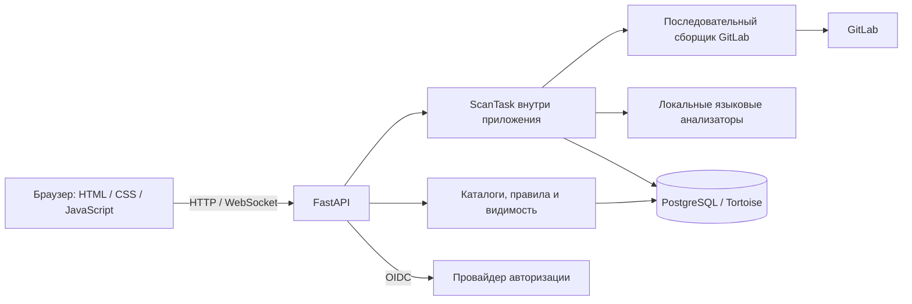
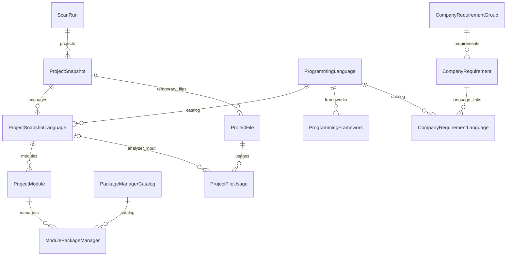

# Архитектура и данные

## Компоненты

Поддерживается одна web-реплика. Сканирование работает фоновым заданием внутри приложения;
отдельного scanner-сервиса, очереди заданий и планировщика пока нет.
Процесс использует PostgreSQL advisory lock для ограничения одновременных запусков.

FastAPI обслуживает API и статические файлы. Frontend — обычные JavaScript-скрипты с общим состоянием.
Статика использует постоянный маршрут и версию по содержимому файлов.

## Основные сущности

`ScanRun` содержит состояние и счетчики запуска. `ProjectSnapshot` связан с GitLab-проектом,
revision и fingerprint анализа; уникальность сейчас задана парой «запуск + GitLab ID».
Пользовательский каталог собирается из JSON `payload` снимков. Языки, модули и пакетные менеджеры
дополнительно представлены связанными таблицами. Это текущая схема, а не модель будущих неизменяемых артефактов.

`ProjectFile` и `ProjectFileUsage` описывают временные входные файлы. Справочники языков,
фреймворков, требований и параметры хранятся независимо от снимков.
Сессии, одноразовые WebSocket-билеты, пользователи и правила видимости — отдельные сущности.
`ApplicationSecret` хранит ключ маскирования webhook; `DataFixture` отмечает применение fixtures.

Актуальность, fallback и очистка истории: [сканирование](scanning.md).

## Исходный код

| Каталог | Ответственность |
|---|---|
| `src/gitlab_radar/api` | HTTP и WebSocket endpoints |
| `src/gitlab_radar/schemas` | Контракты данных, статусы и валидация |
| `src/gitlab_radar/tasks` | Оркестрация сканирования |
| `src/gitlab_radar/clients` | Клиент GitLab |
| `src/gitlab_radar/services` | Сбор, анализ, правила, каталоги и статистика |
| `src/gitlab_radar/database` | ORM-модели, repository, fixtures и миграции |
| `src/gitlab_radar/config` | Настройки приложения |
| `web` | Интерфейс и статические ресурсы |
| `deploy` | Подготовка PostgreSQL |

## API

API начинается с `/api/`. Интерактивное описание FastAPI доступно по `/docs`, OpenAPI — `/openapi.json`.
Основные группы: проекты, зависимости, dashboard, scan, справочники, пользователи, auth и visibility.
Контракты и права конкретных операций задаются router и схемами; общая модель доступа описана
в [авторизации](access.md).

Новый анализатор реализует `LanguageAnalyzer`, регистрируется в registry и объявляет версию,
пакетные менеджеры, выбор файлов и локальный анализ. При изменении результата разбора повышается
версия анализатора; при изменении общего анализа — `PROJECT_ANALYZER_VERSION`.
