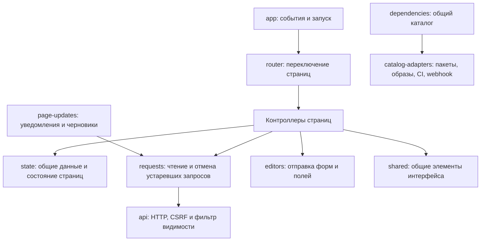

# Frontend

Браузер загружает нативные ES-модули через `app.js`; отдельная сборка не требуется.
FastAPI добавляет import map с общей версией статики, включая динамические импорты.

| Модуль | Ответственность |
|---|---|
| `state.js` | Общие справочные данные; отдельное состояние проектов, обзора, сканирования и каталогов по источнику |
| `requests.js` | Последний запрос по ключу, отмена при инвалидации, совместная загрузка справочных данных |
| `api.js` | HTTP, CSRF, выбранная группа видимости и извещение об изменении данных |
| `page-updates.js` | Уведомления из других вкладок; сохранение введенных данных до явного обновления |
| `catalog-adapters.js` | Заголовки, поиск, разбор путей и представление версий для общего каталога |
| `editors.js` | Блокировка повторного сохранения и единые обработчики форм, полей и действий |
| `project-history.js`, `scan-charts.js` | История пакетов с курсорами и доступные с клавиатуры SVG-графики запусков |
| `navigation.js` | Переходы между контроллерами через динамические импорты |
| `shared.js`, `toasts.js` | Форматирование, элементы DOM, подтверждения и сообщения |

Контроллер страницы читает данные через `readLatest`, затем меняет состояние и отображение.
Ответ применяется только для последнего запроса с той же версией данных и группой видимости.
Справочники загружаются через `ensureResource`, чтобы параллельные страницы использовали один запрос.

Статусы сканирования обрабатываются последовательно для WebSocket и ручных действий.
Устаревший статус не может вернуть завершенный запуск в состояние выполнения.
Курсор пакета изменений продвигается после успешного применения данных проектов.

Изменения справочников передаются между вкладками через BroadcastChannel.
Они отменяют устаревшие чтения и показывают уведомление, сохраняя DOM открытых редакторов.
Сохранение блокирует соответствующий редактор; ошибка не удаляет введенный текст.
Черновики живут в памяти вкладки, без сохранения в localStorage.
