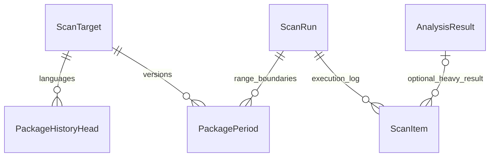

# История проектов, пакетов и запусков

История проекта открывается кнопкой с часами в его карточке. Выбираются цель (ветка или MR),
наблюдение, модуль и пакет. Сейчас сбор работает с основной веткой; история уже разделена
по `ScanTarget`, поэтому разные цели не смешивают версии.

Во вкладке «Изменения» показаны добавленные, удаленные пакеты и изменения версий.
«Известные пакеты» показывает последние подтвержденные версии к выбранному наблюдению.
Нажатие на пакет открывает диапазоны его версий.

## Что сравнивается

Пакет идентифицируется языком, путем модуля, областью использования и именем.
Прямые, транзитивные и отдельные группы опциональных зависимостей учитываются раздельно.
Для Python имена нормализуются по правилам имен пакетов; имена Maven и npm сохраняют свой регистр.
Если для одного пакета записано несколько ограничений версий, сравнивается их упорядоченное множество.
Отсутствие ограничения версии — самостоятельное значение, а не отсутствие пакета.

Сравниваются только полные успешные результаты анализа. Первое наблюдение языка становится
исходной точкой: его пакеты сохраняются, но не выдаются за новые добавления в репозиторий.
Ошибка, частичный анализ, пропуск или отсутствие проекта не подтверждают удаление зависимостей.
Отключенный или неподдерживаемый язык, указанный в результате анализа, не закрывает свои версии.
При выборочном запуске перенос данных остальных проектов не создает новых наблюдений пакетов.

В интерфейсе изменение ограничения версии называется «Изменен»: оно может означать как обновление,
так и откат или изменение диапазона. Перемещение пакета между модулями или группами отражается
как удаление в прежней области и добавление в новой.

## Диапазоны версий

`PackagePeriod` хранит одну версию или набор ограничений и ссылки на запуски:

| Поле | Смысл |
|---|---|
| `scan_from` | Первое успешное наблюдение этой версии |
| `scan_to` | Последнее успешное наблюдение той же версии |
| `closed_in` | Запуск, подтвердивший изменение или удаление; пусто для последней известной версии |
| `baseline` | Исходная точка наблюдений этого языка |

Если пакет не изменился, обновляется `scan_to`; новая строка не создается.
При изменении старый диапазон закрывается и создается новый. При удалении новый диапазон не создается.
Отсутствие наблюдений между границами не означает подтвержденное отсутствие изменений:
пропуски и ошибки видны в истории проекта отдельно.

`PackageHistoryHead` отмечает языки, для которых уже было полное наблюдение, в том числе с пустым
списком пакетов. Запись результата, счетчиков изменений и диапазонов выполняется в одной транзакции;
блокировка цели защищает от повторной обработки. История ограничена теми данными, которые сохранились
к моменту обновления: удаленные прежней очисткой результаты восстановить нельзя.

Worker постепенно заполняет историю оставшихся результатов без запросов к GitLab.
Перед новым наблюдением сначала обрабатывается сохранившаяся предыстория его цели.
Пока заполнение не завершено, интерфейс показывает «История подготавливается».

## Хранение

Записи `ScanRun` и `ScanItem` теперь сохраняются как журнал исполнения: источник и параметры запуска,
время, результат, причины ошибок, диагностика файлов и счетчики изменений пакетов.
История версий не ссылается на тяжелые `AnalysisResult` и не исчезает при их удалении.

`retained_scan_count` сохраняет полные данные последних N опубликованных снимков и N последних
завершенных запусков, включая ошибочные и остановленные. Последние данные целей и их успешный fallback
защищены отдельно. Worker очищает остальные результаты небольшими порциями между запусками и во время
ожидания, сохраняя журнал и диапазоны версий.

При очистке у старых пунктов удаляются ссылки на тяжелые результаты и избыточные метаданные.
Затем удаляются неиспользуемые результаты с модулями. Для старого полного снимка API возвращает `410`,
вместо выдачи неполного каталога. Подробности запуска и пакетов остаются доступны; интерфейс сообщает
об удалении тяжелых данных. Новых env-переменных и изменений команды контейнера не требуется.

## Графики

В истории запусков кнопка «Статистика запусков» открывает графики длительности и результатов
последних 40 запусков с учетом текущих фильтров. По столбцу можно перейти к запуску.
В успешные включено повторное использование анализа; перенесенные данные других проектов исключены.
Графики строятся по сохраненным пунктам журнала и продолжают работать после очистки результатов.
Проекты, отфильтрованные до создания пункта запуска, в эти счетчики не входят.

## API

Проектные маршруты применяют те же проверки видимости и черного списка, что каталог проектов.
Статистика всех запусков доступна администраторам.

| Маршрут | Данные |
|---|---|
| `GET /api/project/{id}/history/targets` | Цели проекта |
| `GET /api/project/{id}/history` | Наблюдения; `target_id`, `before`, `limit` |
| `GET /api/project/{id}/history/{scan_id}/changes` | Изменения пакетов |
| `GET /api/project/{id}/history/{scan_id}/packages` | Последние подтвержденные версии к этому наблюдению |
| `GET /api/project/{id}/package-history/{key}` | Диапазоны версий пакета; `target_id`, `before`, `limit` |
| `GET /api/scan/statistics` | Длительность и результаты; фильтры истории запусков |

Пакеты и изменения читаются порциями: `target_id`, `after`, `limit` (до 100), `language`, `module_path`, `name`.
`after` — непрозрачный курсор из предыдущего ответа. Для диапазонов и наблюдений используется `before`.
