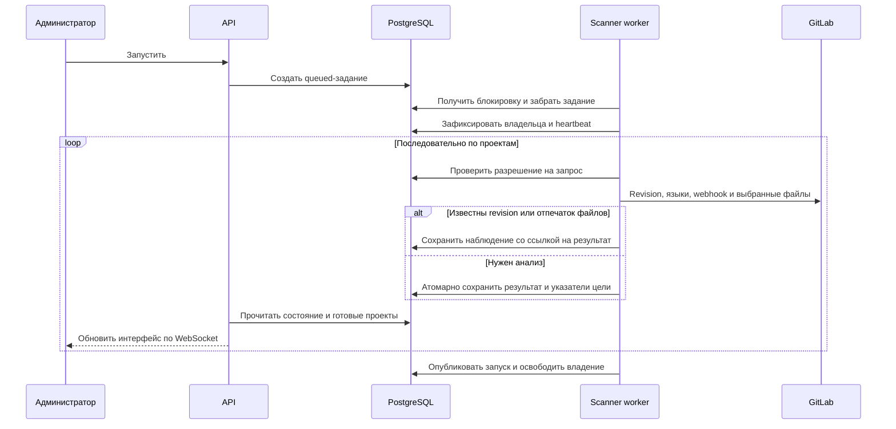

# Сканирование и актуальность

Администратор запускает сканирование вручную. До завершения или остановки текущего запуска
повторный запуск запрещен, включая время ожидания исполнителя. Очередь PostgreSQL — внутренний
механизм передачи задания worker; она сохраняется при перезапуске приложения.
Сейчас обрабатывается основная ветка проекта; сбор других веток, MR и расписания пока не включены.

GitLab опрашивается последовательно. Локальный анализ работает параллельно со сбором и не создает
дополнительных запросов к GitLab. Проекты без основной ветки и проекты черного списка пропускаются.
Собираются активные проекты с доступом Reporter и выше, а также публичные проекты.

## Конвейер

## Обновление каталога

Сбор файлов и локальный анализ выполняются конвейером. Готовые проекты передаются в браузер через WebSocket
и добавляются в конец каталога без перестановки уже показанных строк. Время сканирования проекта фиксируется
в момент публикации результата.

Повторное использование результата зависит не только от Git revision, но и от fingerprint анализа. Fingerprint
включает версии зарегистрированных анализаторов, их пакетные менеджеры, набор включенных языков и адрес GitLab.
При той же revision файлы повторно не скачиваются. При новой revision выбранные файлы проверяются
по отпечатку отсортированных путей и содержимого: одинаковые входы позволяют пропустить локальный анализ.
Метаданные и webhook обновляются в обоих случаях. Добавление
анализатора или повышение его версии приводит к повторному анализу проекта даже при неизменной revision.

Если сканирование выполняется или было прервано, еще не обработанные проекты отображаются через сохраненные ссылки на прежние
результаты и помечаются как устаревшие. После успешного сканирования проект, которого больше нет в выдаче
GitLab, сохраняется со статусом «Не найден при последнем сканировании». Такие проекты продолжают участвовать
в статистике. При следующем успешном обнаружении свежий результат заменяет сохраненные данные.

История запуска использует зафиксированные ссылки, а не последний результат цели.
Успешный результат отдельного проекта доступен сразу, даже если весь запуск впоследствии прерван.
Fallback ошибки выбирается только из успешных результатов той же цели; другая ветка его не подменяет.

Администратор может добавить полный путь или glob-шаблон в раздел «Черный список». Совпавшие проекты
отбрасываются до сбора и сохранения данных. Ранее сохраненные snapshot таких проектов также не возвращаются
в API и не переносятся в новые сканирования.

## Статусы

Статус запуска и качество анализа проекта — разные характеристики. Завершенный запуск может
содержать ошибки отдельных проектов; они перечисляются в его состоянии.

| Объект | Статусы |
|---|---|
| Запуск | `idle`, `queued`, `running`, `stopping`, `cancelled`, `completed`, `failed` |
| Этап | `idle`, `collecting`, `analyzing`, `publishing`, `completed` |
| Результат проекта | `pending`, `success`, `partial`, `failed` |
| Результат языка | `pending`, `disabled`, `unsupported`, `analyzed`, `partial`, `failed` |
| Актуальность данных | `current` — текущие данные; `stale` — прежние данные; `missing` — проект не найден |

Частичный анализ сохраняет исправные модули, но не считается успешным кэшем. При полном отказе
используются предыдущие успешные данные, если они есть. Диагностика файлов доступна в карточке проекта;
[ограничения форматов](analyzers.md) помогают отличать поврежденный файл от неподдержанной конструкции.

## Остановка и восстановление

Кнопка остановки отменяет ожидающее задание сразу. Выполняющийся запуск переходит в `stopping`:
новые запросы и запись результатов запрещаются, текущая операция завершается. Только после завершения
потоков запуск получает `cancelled`. Уже сохраненные результаты остаются доступны.

HTTP-запросы GitLab имеют таймаут 20 секунд на сетевое ожидание. Ожидание после 429 прерывается
сигналом остановки; число попыток ограничено тремя. Если ограничение сохраняется, запуск завершается
ошибкой. Принудительного завершения потока или произвольного кода анализатора нет.

Worker удерживает PostgreSQL advisory lock, обновляет heartbeat и срок владения заданием.
Перед каждым HTTP-запросом проверяется запись задания, а сохранение результата проверяет токен владельца
в транзакции. При потере блокировки worker прекращает новые операции и дожидается текущих потоков.
Пока они завершаются, он продолжает подтверждать владение, если соединение с БД доступно.

После аварийного завершения worker другой исполнитель помечает запуск с истекшим сроком владения
ошибочным (или отмененным, если была запрошена остановка), удаляет временные файлы и продолжает очередь.
Старый запуск не возобновляется автоматически. Истекшее владение не позволяет старому worker публиковать результат.

API: `POST /api/scan/` запрашивает запуск и возвращает `409`, если уже есть ожидающее, выполняющееся
или останавливаемое сканирование. `GET /api/scan/` возвращает активный запуск,
первый ожидающий или последний завершенный. `GET /api/scan/{id}` читает конкретный запуск;
`POST /api/scan/{id}/stop` запрашивает остановку. Изменяющие операции доступны администратору.

## Хранение

В PostgreSQL раздельно хранятся цели, пункты запусков и неизменяемые результаты анализа.
Конфигурационные файлы временно сохраняются как текст; после анализа удаляются.
Метаданные наблюдения не содержат копии списка модулей и зависимостей.

Параметр `retained_scan_count` задает число опубликованных запусков: старые наблюдения удаляются после
публикации нового. Результат сохраняется, пока на него ссылается наблюдение, fallback или указатель
последнего успеха цели. Неиспользуемые результаты очищаются отдельно. История неудачных
неопубликованных запусков пока не ограничивается этим параметром.

Структура сущностей: [архитектура и данные](architecture.md).
