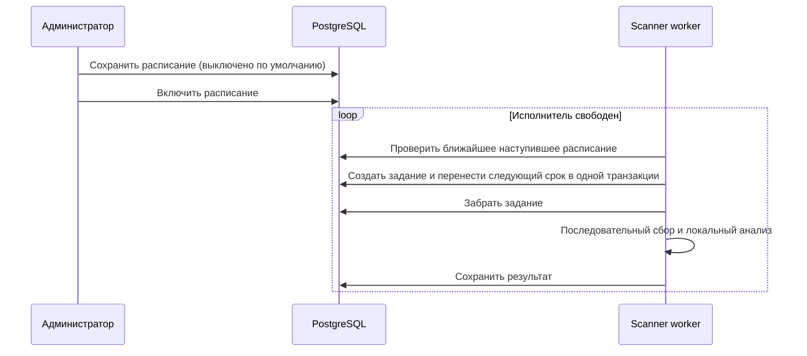

# Расписания и история запусков

Ручной запуск остается базовым. Новые расписания выключены; их можно включать и выключать
в разделе «Управление → Расписания». Время задается по часам сервера, без выбора часового пояса.
Расписание содержит название, время, дни недели и параметры запуска.

## Общие параметры

| Параметр | Поведение |
|---|---|
| ID проектов | Пустое значение означает все доступные проекты; список ограничивает сбор выбранными проектами |
| Повторить анализ даже без изменений | Заново скачивает выбранные файлы и выполняет анализ, обходя кеш готовых результатов |

Ручной запуск и расписания используют одну модель параметров. В запуске сохраняется копия параметров
и название расписания; последующее редактирование расписания не меняет уже созданное задание.
Отдельный проект проверяется по текущей основной ветке. Остальные проекты сохраняют прежние данные,
статусы и время анализа. В списке пунктов выборочного запуска показаны только выбранные проекты.

## Исполнение

Планировщик работает внутри scanner worker, удерживающего общую блокировку исполнителя.
Ручные, повторные и плановые задания используют одну блокировку допуска в PostgreSQL:
новый запуск не создается, пока есть ожидающее, выполняющееся или останавливаемое задание.

Если время расписания наступило во время работы или простоя приложения, оно остается ожидающим
до освобождения исполнителя. Пропущенные интервалы объединяются в один запуск; после его создания
следующее время рассчитывается от текущего момента. Несколько наступивших расписаний обслуживаются
по времени ожидания, затем по ID. Выключение отменяет ожидающий срок, повторное включение выбирает
ближайший будущий срок. Уже созданный запуск продолжается; его можно остановить отдельно.

Расписания и следующий срок хранятся в БД и переживают перезапуск. Для выключенных расписаний
следующий срок отсутствует. Изменение только названия или параметров сохраняет уже рассчитанный срок;
изменение времени или дней недели пересчитывает его.

## Экраны управления

- **Текущий запуск:** состояние, источник, инициатор, параметры, прогресс и ошибки; кнопка запуска
  меняется на остановку. «Показать пункты запуска» открывает подробности.
- **Расписания:** создание, редактирование, включение, выключение и удаление. Из карточки можно
  перейти к истории конкретного расписания. Обновление списка не перезаписывает открытый редактор.
- **История запусков:** фильтры статуса, источника и расписания; список загружается страницами.
  Подробности показывают счетчики, ошибки и пункты с отдельным фильтром и пагинацией.
  В пункте доступны revision, fingerprint и диагностика файлов.

Административные вкладки и изменяющие операции доступны администраторам. Остальным авторизованным
пользователям остается просмотр текущего статуса.

Завершенный или остановленный запуск можно повторить с сохраненными параметрами. Повтор проекта
создает новое задание только для этого проекта. Оригинальный запуск не изменяется; у нового сохраняется
ссылка на исходный. Повтор запрещен, пока выполняется другое задание.

Журнал запусков и их пунктов сохраняется после очистки тяжелых результатов.
В карточке запуска показано, если полный снимок уже удален; причины ошибок и диагностика остаются.
Кнопка «Статистика запусков» открывает графики длительности и результатов с учетом фильтров.
Подробности: [история проектов и пакетов](history.md).

## API

Все перечисленные маршруты требуют прав администратора.

| Маршрут | Действие |
|---|---|
| `GET /api/scan/history` | История; `before`, `limit` (до 100), `state`, `source`, `schedule_id` |
| `GET/POST /api/scan/schedules` | Список и создание расписаний |
| `PUT/DELETE /api/scan/schedules/{id}` | Изменение и удаление |
| `PATCH /api/scan/schedules/{id}/enabled` | Включение или выключение |
| `GET /api/scan/{id}/items` | Пункты; `after`, `limit` (до 100), `state` |
| `GET /api/scan/{id}/items/{item_id}` | Подробности пункта |
| `POST /api/scan/{id}/retry` | Повтор запуска |
| `POST /api/scan/{id}/items/{item_id}/retry` | Повтор проекта |

`POST /api/scan/` принимает необязательное тело `{"project_ids": [123], "force_analysis": false}`.
Без тела выполняется обычное сканирование всех доступных проектов.
