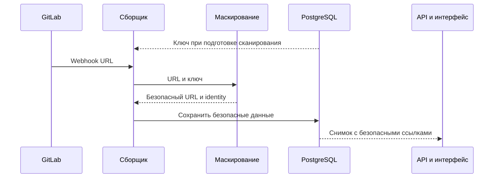

# Безопасные ссылки webhook

Webhook собираются для проектов с доступом Maintainer или Owner. Недоступность списка webhook
фиксируется отдельно от отсутствия самих webhook.

Перед сохранением backend удаляет данные авторизации и fragment URL, заменяет непустые сегменты
после `/hooks/` и значения query-параметров с `token` или `secret` стабильными уникальными масками.
Остальные части URL сохраняются. Разные скрытые значения остаются различимыми в карточках и каталоге;
frontend показывает уже безопасный URL.

Ключ хранится в БД и не зависит от web-сессий. Старые ссылки очищаются миграцией `0011`;
при обычном старте истории повторно не маскируются. Схема не охватывает ранее сделанные резервные копии.

Правила компании сравнивают безопасные ссылки: использовать скрытый секрет в условии нельзя.
